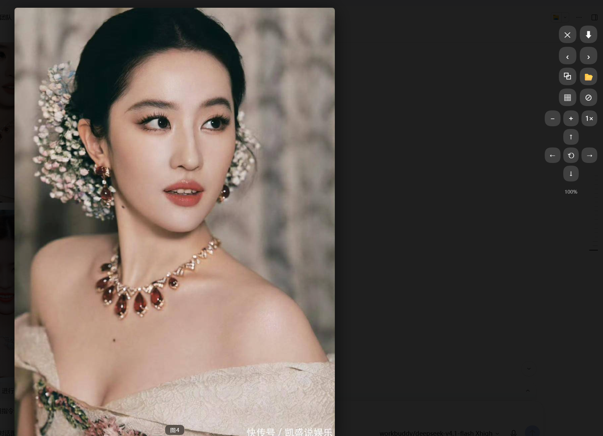
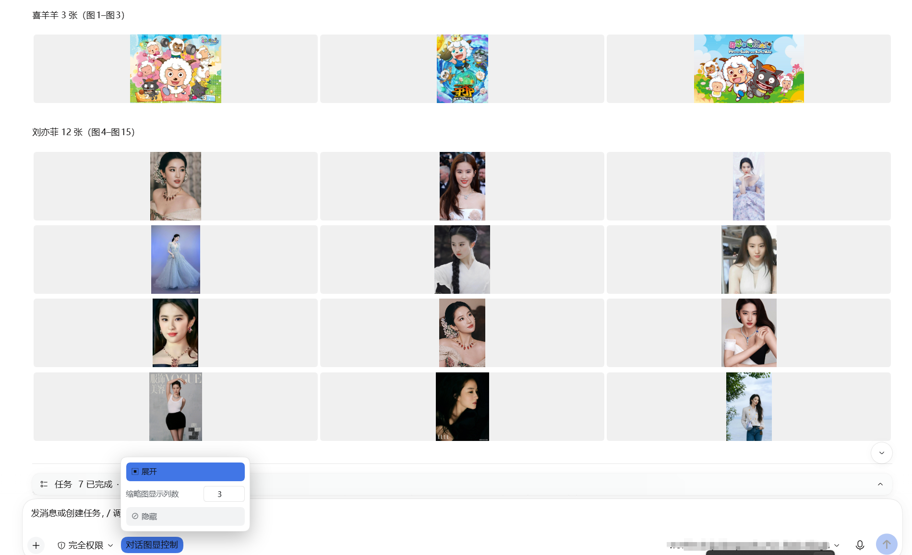
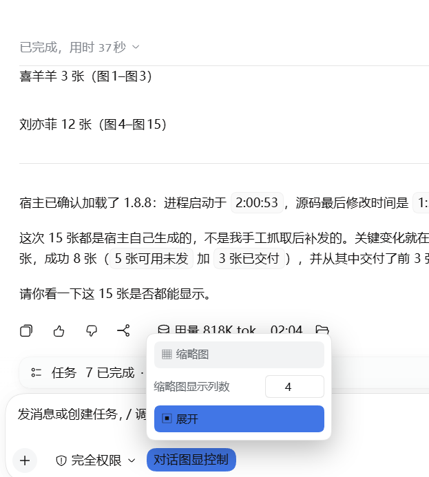

# DSH Chat Image Lightbox 🖼

> ### 🛡 v1.7.8 — 强制图片出现在正文里 / Images must land in the reply body
>
> **工具行是折叠的，用户看不到。** 从 1.7.8 起插件会在 system prompt 里常驻一条铁律，
> 要求模型把每张交付的图**写进回复正文**（``），不许只依赖 `display_image` 的工具调用行。
> 这解决的是「图其实渲染好了、但用户以为没发」的经典误判。
>
> **Tool rows are collapsed — the user never sees them.** Since 1.7.8 the plugin keeps a resident
> system-prompt rule requiring every delivered image to appear in the reply body, not only inside the
> `display_image` tool row. Opt out with `config.injectImageLaw: false`.

> ### 🛠 v1.7.5 — 发图片失败已修复 / Image-sending bug fixed
>
> **如果你在 DSH 里发图片失败**（报 `prompt rejected` + `ERR_DLOPEN_FAILED` + `session/agent-busy`，纯文字正常），
> 那是 **1.7.4 及更早**的已知问题，**1.7.5 已修复**。升级 + 重启 DSH 即可：
>
> ```sh
> pnpm add dsh-chat-image-lightbox@latest
> ```
>
> 原因：本插件旧版把 `sharp` 精确锁在 `0.34.4`，与 DSH 内核的 `^0.35.3` 冲突，两个版本争抢同名 `libvips-42.dll`。
> 详见 [Release v1.7.5](https://github.com/loyalchiiina/dsh-chat-image-lightbox/releases/tag/v1.7.5) · 排查见 [⑥ 发图失败](#发图片时提示-sessionagent-busy-errdlopenfailed175-已修复) 与 [Troubleshooting ⑥](#sending-an-image-fails-with-sessionagent-busy-errdlopenfailed-fixed-in-175)。
>
> **If sending an image fails** with those errors (plain text works fine), it is a known issue in **1.7.4 and earlier**, **fixed in 1.7.5**. Upgrade and restart DSH. Cause: the old version pinned `sharp` to `0.34.4`, conflicting with the kernel's `^0.35.3` over the same-named `libvips-42.dll`.

**对话里的图，值得被认真看。**

**Images in chat deserve a proper look.**

[English](#english) | [中文](#中文)

> 📦 **npm 包名 / npm package name**：`dsh-chat-image-lightbox`（无 scope / unscoped）
> 旧包名 `@loyalchiiina/dsh-chat-image-lightbox` 已被取代，历史版本已标记弃用。
> The legacy scoped name `@loyalchiiina/dsh-chat-image-lightbox` is superseded; its older versions are deprecated.

```bash
dsh plugin --profile desktop add dsh-chat-image-lightbox
```

> **当前版本 / Current version**：`1.7.8`
> **适用内核 / Requires**：本包声明 `engines.dsh: ">=0.1.7-rc.1"` 与 `peerDependencies["@deepseek-ai/dsh"]: ">=0.1.7-rc.1"`（不硬绑具体内核版本）；本版实测验证于 **DSH NEXT 2.0.18-next**，客户端组件 `@deepseek-ai/dsh-client-ui-tool` 实测 `0.2.1-alpha.2`。
> This package declares `engines.dsh: ">=0.1.7-rc.1"` and `peerDependencies["@deepseek-ai/dsh"]: ">=0.1.7-rc.1"` (no hard pin to a specific kernel); this release was verified end to end on **DSH NEXT 2.0.18-next**, with `@deepseek-ai/dsh-client-ui-tool` measured at `0.2.1-alpha.2`.

> ⚠️ **升级到 1.7.3 前请注意 / Before upgrading to 1.7.3**
> 1.7.2 起 **移除了「跳图」功能**（该功能在多次迭代中不够稳定，已整体删除，界面上不再出现 ⌖ 按钮）。
> Since 1.7.2 the **jump-to-image feature was removed** — it proved unreliable across iterations and has been deleted outright; no ⌖ button appears anymore.

## 效果预览 · Screenshots

### 灯箱查看 · Full-screen lightbox



> 原图完整显示（自动适配屏幕高度），右上角是「⬇ 下载」与「✕ 关闭」；同一条消息里的其他图片可连续翻页浏览。
> The full-resolution image auto-fits the viewport, with ⬇ download and ✕ close in the top-right; other images in the same message can be paged through.

### 缩略图分列 · Thumbnail grid with adjustable columns




> 一键把整个会话的图片收成网格；面板里的「缩略图显示列数」可设 1–12 列，输入的值会保存为默认值。
> One click collapses every image in the conversation into a grid; the **缩略图显示列数** field sets 1–12 columns and the value is saved as your default.

### 隐藏 / 展开 · Hide / restore



> 一键隐藏所有图片，**并把它占的空间完全收掉**（不会留下空白带）；再点一下原样恢复。
> One click hides every image **and closes up the space it occupied** (no blank band left); another click restores everything.

---

## 功能总览 · At a glance（中英对照 / Bilingual）

### 灯箱查看 · Lightbox viewer

| 中文 | English |
|---|---|
| 点击任意对话图片进入全屏灯箱 | Click any chat image for a full-screen lightbox |
| 滚轮缩放、拖拽平移 | Wheel zoom, drag to pan |
| 工具栏缩放按钮 ⊕ ⊖ 与 1× 复位 | Toolbar ⊕ / ⊖ zoom buttons with 1× reset |
| 方向键平移视角（按住连续移动） | D-pad moves the view (press-and-hold repeats) |
| 左右翻页：按钮 / 键盘 / 触屏滑动 | Prev/next via toolbar, keyboard or swipe |
| 下载原图（自动识别扩展名） | Download original (extension auto-detected) |
| 复制图片文件绝对路径 | Copy the image's absolute local path |
| 在文件夹中显示（资源管理器定位） | Reveal in folder (file manager locates the file) |

### 会话级图片控制 · Conversation-wide controls

工具行里的 **「对话图显控制」** 按钮打开面板，面板内含三项：

The **"对话图显控制"** button in the composer row opens a panel with three controls:

| 中文 | English |
|---|---|
| **缩略图**：一键把整个会话的图片收成网格 | **Thumbnail**: collapse every image in the conversation into a grid |
| **缩略图显示列数**：1–12 可调，改过即存为默认值 | **Columns per row**: 1–12, and your value is saved as the default |
| **隐藏**：一键隐藏 / 再点恢复，**不留空白** | **Hide**: hide / restore all images, **leaving no blank space** |

> 列数说明：默认 3 列。设置后会记住，下次启动仍用该值；改回其他值即覆盖默认。
> Columns: 3 by default. The value is remembered across restarts; changing it again simply replaces the stored default.

### 格式与清晰度 · Formats & fidelity

| 中文 | English |
|---|---|
| **TIFF/TIF、HEIC 自动转换显示** | TIFF/TIF, HEIC auto-transcode for display |
| TIFF/PNG/BMP **无损原像素**（逐像素零误差） | TIFF/PNG/BMP lossless, **native pixels** (bit-exact) |
| 2 亿像素大图流畅显示 | 200-megapixel images display smoothly |
| 11 种格式实测支持（JPG/PNG/WebP/GIF/AVIF/SVG/BMP…） | 11 formats verified (JPG/PNG/WebP/GIF/AVIF/SVG/BMP…) |
| **网图被防盗链拦截时自动转存本地显示** | **Hotlink-protected remote images are auto-saved locally** |

### 宿主侧工具 · Host-side tool (`display_image`)

| 中文 | English |
|---|---|
| 关键词搜网图（Bing/花瓣/搜狗 3 源回退，按抽样可加载率选源） | Keyword image search (Bing / Huaban / Sogou fallback, source chosen by sampled loadability) |
| 搜图自动过滤广告与他人面孔 | Auto-filters adverts & other celebrities |
| 本地文件/目录直读（TIFF/HEIC 转码） | Read local files/dirs (TIFF/HEIC transcoded) |
| 网图落地保存到本地目录（`save_to`） | Save remote images to a local folder (`save_to`) |
| **能直连就直连，被拦截才自动转存** | **Direct CDN when it works, local copy only when blocked** |
| 代理自动探活（无需手配） | Auto proxy discovery (TCP probe) |

### 隐私与安全 · Privacy & safety

| 中文 | English |
|---|---|
| 一切本地服务仅回环（loopback-only） | All local services are loopback-only |
| 打开文件夹用参数化调用，绝不拼接 shell 命令 | "Show in folder" spawns argv, never a shell string |
| 保存说明不回显本机路径 | No local paths echoed in confirmations |
| 只作用于对话区图片，不碰侧栏/头像 | Only touches conversation images, never the sidebar or avatar |

---

## English

A [DeepSeek Harness](https://github.com/deepseek-ai/deepseek-harness) plugin that displays images inline in the chat with a lightbox overlay — zoom, download (save-as dialog), and prev/next navigation.

Pictures from your agent sit tiny inside a bubble — to see detail you have to save them and open elsewhere. With this plugin, **one click opens any chat image full-screen**: zoom, drag-pan, download, and flip through the others in the same message.

### Features

- **Inline display**: Images in AI responses render directly in the chat (via markdown ``)
- **Click to zoom**: Click any image to open a full-screen lightbox; clicking the enlarged image zooms in again, and clicking while already zoomed **closes** the lightbox (the zoomed image covers the backdrop, so this guarantees the close target is reachable). `Esc` or clicking the backdrop also closes it.
- **Scroll to zoom & pan**: When zoomed in, use the mouse wheel to zoom further and drag to pan around the image
- **Download**: Click the download button ⬇ to save the image (triggers browser save-as dialog for same-origin images; filename is sanitized and the extension is derived from the image type)
- **Navigation**: Left/right arrow buttons, keyboard arrows, or swipe left/right on touch devices to switch between multiple images
- **Caption**: The viewer shows the current image's filename/caption
- **Accessible**: The lightbox is a proper `role="dialog"` with `aria-modal`, button `aria-label`s, and focus management (focus returns to the trigger on close)
- **Smooth**: Adjacent images are prefetched so navigation feels instant
- **Close**: Click backdrop, press Escape, or click ✕ to close
- **ZCode-style rendering**: chat images are styled in place — never moved, resized or reparented — so DSH's React virtual list is never fought with (no more vanished/duplicated images or console `removeChild` errors)
- **Capped, not cropped**: every chat image renders with its aspect ratio preserved, capped at `min(460px, 64vh)` height (the ZCode look); charts and diagrams stay fully readable
- **Responsive image row**: when one message contains **multiple images** in one container, they lay out as a responsive CSS-grid row — via a class on the container only, without moving any nodes
- **HD original on open**: clicking any image opens the lightbox with the **full-resolution original image** — zooming in shows the real high-resolution file
- **Clean UI**: The lightbox toolbar (download / close), prev/next arrows, counter and caption are **hidden whenever the lightbox is closed** — they only appear while you are actually viewing an image, so they never clutter the chat layout
- **Zoom / pan pad**: the lightbox also has explicit controls for what the gestures do — `⊖` `⊕` `1×` for zoom with a live percentage readout, and a d-pad for moving the view (press and hold to keep moving). Wheel, drag and `+`/`-`/`Shift+arrow` all still work
- **Conversation-wide image controls in one popover**: a single compact **「对话图显控制」** trigger sits next to the access-mode control and slides out a panel with the thumbnail switch, the hide switch and the column field — no row of buttons cluttering the composer
- **Thumbnail grid with configurable columns**: one click collapses **every** image in the conversation into a grid of small tiles. The **缩略图显示列数** field sets the **columns per row (1–12)**; the value you enter is saved and reused on the next launch
- **Hide / show**: one click hides every image and the space it occupied closes up completely (no blank band left behind); another click brings them back intact
- **Only conversation images**: the plugin deliberately ignores pictures outside the message list — the signed-in account avatar and the sidebar glyphs are ordinary `` elements too, and they are left untouched (fixed in 1.7.2)
- **Safe by construction**: the thumbnail look is applied with classes and inline styles only. No node is ever moved, removed or reparented — an earlier build that did so made DSH's conversation slot throw `DOMException` and render the transcript empty
- **Auto-enhance**: MutationObserver automatically enhances new images added to the chat, and re-adopts images whose class a React re-render overwrote
- **Bring images into the chat (`display_image` tool, host side)**: one tool takes a local `path` (file **or** directory — TIFF/HEIC transcoded, optional downscale), a remote `url`, or a `query` (keyword image search: Bing first, then Huaban and Sogou — each source is gated by a sampled loadability check, so a source that has results but no loadable pictures is skipped) and returns ready-to-paste Markdown. Any file on this machine can be served in place via `/images/?abs=<path>` (loopback-only), no copying into the gallery root required
- **Hotlink fallback (1.7.2)**: a search result can answer `200` and still fail in the browser, because some CDNs (Huaban via Tencent EdgeOne) reject any request whose `Referer` is not their own domain — the picture then shows as "无法预览". The tool now probes each URL the way a browser would and **only** re-saves the ones that would be blocked, so working links stay direct and nothing is downloaded unnecessarily
- **Source-health gate (1.8.1)**: "the API answered with results" used to be read as "the source is usable". Huaban's search API keeps answering `200` with twenty pins while **every** one of its image URLs returns `567` from Tencent EdgeOne — so a search returned five pictures that all rendered as "图片无法预览", and because the first source "had results" the search never fell through to another one. Each source is now **sampled (4 URLs, probed the way a browser would)**; below a 30% loadability ratio the source is skipped with the reason recorded, and if no source clears the bar the best one is used with that stated plainly in the note. Source order is now the one that measurably works (**Bing → Huaban → Sogou**; Sogou now answers anonymous callers with `forbid`, which is reported as "source unavailable" instead of being silently read as "no pictures found")
- **Concurrent rescue (1.8.1)**: rescuing blocked images was serial — ten pictures took 18.4s. It is now four lanes wide (result order preserved, one failure does not cancel the rest), and URLs already probed by the health sample are not probed a second time
- **Failures are stated (1.8.1)**: a failed rescue used to vanish into an empty `catch (e) {}`, leaving the user with broken thumbnails and a silent log. The reason is now recorded on `rescueError` and surfaced in the note ("N images were blocked by the origin and could not be rescued"), so "no image came through" is at least **visible**
- **The auto-rescue cache no longer grows forever (1.8.1)**: `~/.dsh/image-gallery-auto` was write-only (measured: 129 files / 187 MB). It is now checked before every rescue and pruned oldest-first past 500 files or 512 MB (a file that cannot be deleted does not abort the sweep)
- **Survives a Junction install (1.8.4)**: the plugin is a directory **Junction** into `local-plugins` in all three profiles. Node resolves `require` from the module's **real path**, so `createRequire(import.meta.url)("sharp")` walked up from `local-plugins/` while `sharp`/`undici` live in `profiles/<name>/node_modules` — the link cut them out of the chain. Consequence: the startup line said `sharp: unavailable` and **every TIFF/HEIC rendered as "图片无法预览"**, and `undici` was unreachable too. `resolveDep()` now searches several roots (module path / `process.execPath` / `EXEPATH` / `cwd`, eight levels up each) and all three dependencies go through it
- **Direct really means direct (1.8.4)**: with `NODE_USE_ENV_PROXY=1`, Node's global `fetch` applies `HTTPS_PROXY` **by itself** — omitting `dispatcher` does not mean "no proxy". Hosts that only answer direct requests (duitang) were therefore reported as "probe failed" and good images were dropped as broken. Direct fetches now use `node:https` with an **explicit Agent** (ignoring env proxies entirely, 5 redirect hops max); `getBytes()` tries runtime fetch first and falls back to direct on transport failure, treating an HTTP status as the answer rather than grounds for a second route
- **The body no longer points at a file the browser cannot decode (1.8.5)** — once 1.8.4 fixed
  `sharp`, TIFFs displayed correctly **in the tool row** but still showed "图片无法预览" **in the
  reply body**, because those two paths are served by different handlers. A body image written as
  `` is rewritten by the Host into `api/file?path=…`, and `serveFile()` there does
  nothing but `mime.lookup(extension)` and stream the **original bytes** through — no transcoding at
  all. Chromium has no TIFF/HEIC decoder, so the `` fails. Every local picture is now
  transcoded to a browser-renderable copy before delivery (lossless sources → PNG, others → WebP
  q92); the body names that copy while `localPath` keeps the original. If the result still exceeds
  the Host's per-image limit (default 20 MB — a 413 which also renders as "图片无法预览"), the width
  is reduced by 0.7 and retried, five rounds at most. Files whose extension says image but whose
  magic bytes say otherwise (a saved CDN error page) are dropped before delivery with the reason
  stated ("后缀是 .jpg，内容却不是图片") instead of a vague transcode failure
- **Search no longer ships unaudited links (1.8.7)**: "4 of 35 loadable" describes the source's overall quality, not whether THIS picture will render. Every candidate is now downloaded and magic-byte checked before delivery; dead links (sinaimg 404 NoSuchKey) and 307s onto another image host (renwuji → static.xsite.com.cn) are dropped, and the note reports how many failed and why.
- **Body numbering continues across batches (1.8.7)**: `display_image` takes a new `start` argument. Pass "last number + 1" for every batch after the first, and the reply numbers 图1..图N instead of restarting at 图1.
- **Real HEIC never worked before (1.8.6)**: the only `.heic` sample on this machine was actually a JPEG (`FFD8FF` leading bytes — the extension lied), so "HEIC verified" was false; sharp's bundled libheif is built **without an HEVC decoder**, so it reads the container fine and throws the moment pixels are requested (`Support for this compression format has not been built in: HEVC`). On Windows the plugin now falls back to the system WIC decoder (`-EncodedCommand`, so no path ever crosses a command line); measured a genuine 1440x960 HEIC → 520x347 PNG in 532 ms. New `test/probe-heic-real.mjs` (24 checks) ships a real HEVC fixture and asserts the fixture itself is not a mislabelled JPEG.
- **Trust the bytes, not the `200` or the content-type (1.8.4)** — one "successfully rescued"
  cache file was actually a CDN error page (HTTP 200, `content-type: image/jpeg`, body starting
  `<!doctype html>`). It was served as `image/jpeg`, the browser failed to decode it, and the
  result was "图片无法预览". Download, probe and serve now all verify the magic bytes
  (JPEG/PNG/GIF/WEBP/TIFF/BMP/ISOBMFF) and refuse anything that is not an image — a file that
  lies about itself gets a 415 with the reason instead of a silent broken picture.
- **Filenames containing `%` now resolve (1.8.4)** — `?abs=` was percent-decoded twice, so
  `a%20b.jpg` became `a b.jpg` (404) and `折扣50%的图.jpg` threw an uncaught `URIError` that
  killed the request. The already-decoded value is used as-is now, with a single fallback decode
  only when that path is not on disk, and a 400 for malformed escapes.
- **"Probe failed" no longer counts as "loadable" (1.8.3)**: health sampling used to split results only into "blocked" and "not blocked", so a **network/TLS failure — where nothing was measured at all — was counted as loadable**. One real search had 2 of 4 probes fail with `fetch failed` while the note still claimed "4 loadable" and `ratio` stayed at 1.0, so the gate never switched sources and the user still got broken images. Results are now counted three ways (loadable / blocked / probe-failed) and `ratio` is decided **only by confirmed 2xx images**; the note and the skip reason state each count separately ("N blocked by the origin" vs "N probe-failed, unverified")
- **Image-delivery law (1.7.8)**: the plugin keeps a resident system-prompt rule (`image-gallery:delivery-law`, order 1500) requiring every delivered image to appear **in the reply body** as `` markdown rather than only inside the `display_image` tool row. **Tool rows are collapsed by default**, so a user scrolling the transcript sees nothing and reasonably concludes no image was sent. The rule also forbids "see above" / "sent N images" phrasing and forbids passing off a file path or a bare link as a delivered image. Opt out with `config.injectImageLaw: false`.

### Installation

#### Method 1: npm (recommended)

```sh
dsh plugin --profile desktop add dsh-chat-image-lightbox
```

#### Method 2: Manual

1. Copy the `lib/` folder and `cordis.patch.yml` to your DSH profile's `node_modules/dsh-chat-image-lightbox/`
2. Add `dsh-chat-image-lightbox` to your profile's `package.json` → `dsh.profile.bundles` array
3. Restart DSH Desktop

### Usage

1. Place images in `~/.dsh/uploads/` (or any directory served by your DSH instance)
2. In your AI response, use markdown image syntax with a **root-relative** path:
   ```
   
   ```
3. The image will display inline with lightbox enhancement

> ⚠️ **Never use `http://127.0.0.1:<port>/images/...`.** DSH Desktop renders the GUI
> inside the custom protocol `dsh-app://app`, so the loopback `http://` origin is a
> *different* origin: Chromium blocks it in the renderer before the request ever
> reaches the web server (`fetch` throws `TypeError: Failed to fetch`, `` fires
> `onerror`). Root-relative paths inherit the page origin (`dsh-app://app`) and are
> forwarded correctly — measured `200 / image/webp / 120×213`. The host half has
> emitted root-relative URLs since v1.7.7; v1.7.8 in this repo only documents it.

**Note**: For the download button to trigger a save-as dialog, the image must be served from the same origin as your DSH instance (e.g., via the `/images/` route). Cross-origin images will open in a new tab instead.

### Troubleshooting image display (important)

When an image shows as blank, a blob of text, or the lightbox opens empty, check in this order:

#### ① Images must use an http(s) URL or a root-relative path — base64/data-URI and attachments are NOT rendered

DSH renders images into `` only from http(s) URLs **or site-root-relative paths**. It does **not** render `data:image/png;base64,...` inline, nor "file-delivery/attachment" messages (those appear as tool-call text, not an image).

- ✅ Correct — markdown + **root-relative** path (what the `display_image` tool emits):
  ```
  
  ```
- ✅ Correct — any non-hotlink-protected external image:
  ```
  
  ```
- ❌ Will NOT render — absolute loopback URL (blocked cross-origin under `dsh-app://app`):
  ```
  
  ```
- ❌ Will NOT render — base64 inline:
  ```
  
  ```

#### ② Blank image / empty lightbox = hotlink protection on the image host (source limit, not this plugin)

Some hosts (e.g. **Sina Weibo sinaimg**, some CDNs) enforce `Referer`-checking: a request without the expected `Referer` returns 403, so the image frame renders but no pixels load (clicking still opens the lightbox, but there is no image).

- No normal webpage can hotlink these directly (including all sites except Weibo) — this is not something any plugin can fix.
- **Workaround**: download the image to `~/.dsh/uploads/` (fetch with a proper `Referer`, or just save it from the browser), then serve it via `/images/`.

Example — fetching a hotlink-protected image (Windows):
```
curl -e "https://weibo.com" -o image.jpg "https://wx1.sinaimg.cn/.../xxx.jpg"
```

#### ③ Supported image formats

| Format | Displayed | Notes |
|--------|-----------|-------|
| jpg / jpeg / png / gif / webp / bmp / svg / ico / avif | ✅ Directly | Mainstream formats — display + lightbox work, bytes untouched |
| **tiff / tif** | ✅ Via server conversion | Browsers can't render TIFF; the plugin server converts it to WebP at full original resolution (bundled `sharp`) — HD display, and download keeps the original `.tif` |
| **heic** | ✅ Via server conversion | Same as TIFF — displayed as WebP, downloaded as the original `.heic` |

Files go in `~/.dsh/uploads/` and display via `/images/` — no manual conversion needed.

#### ④ Plugin not working after changes — restart fully

After installing or editing plugin files, **fully quit all DSH Desktop processes** (Task Manager → end every `DSH Desktop.exe`) and reopen. Closing just the window does not quit (background processes stay). Old/unloaded code keeps the plugin inactive otherwise.

#### ⑤ Is it actually the plugin? Quick checklist

- Test with a `/images/`-served upload — if it displays and lightboxes, the plugin is fine.
- Test with a non-hotlink-host image (e.g. `https://picsum.photos/800/600`) — if that works, the plugin is generic.
- If neither uploads nor external images lightbox → the plugin client didn't load, usually because DSH wasn't fully restarted or the install is incomplete.

#### ⑥ Sending an image fails with `session/agent-busy` / `ERR_DLOPEN_FAILED` (fixed in 1.7.5)

If **sending an image** fails with:

```
prompt rejected: Could not load the "sharp" module using the win32-x64 runtime
ERR_DLOPEN_FAILED: The specified procedure could not be found.
(session/agent-busy)
```

this is a known issue in **1.7.4 and earlier**, **fixed in 1.7.5**. Just upgrade:

```
pnpm add dsh-chat-image-lightbox@latest
```

**Why it happened**: the DSH kernel ships `sharp ^0.35.3`, while older versions of this plugin **pinned sharp to exactly `0.34.4`** — putting two different sharp builds into one process. They load a DLL with the **same filename** (`libvips-42.dll`) but need different companions (`libvips-cpp-8.17.2.dll` for 0.34.x vs `libvips-cpp-8.18.3.dll` for 0.35.x). **Windows resolves DLLs by filename**, so whichever loads first claims the name and the other fails with "the specified procedure could not be found".

The trailing `agent-busy` is a generic wrapper the kernel applies to **unclassified errors** — it has nothing to do with actual concurrency, which is why the real cause is hard to spot from the message alone.

> Note: this only ever affected **sending images**; plain text chat was never impacted.

### Keyboard & Mouse

| Action | Input |
|--------|-------|
| Open lightbox | Click an image |
| Zoom in / out | Click image, or mouse wheel when zoomed |
| Pan | Drag the image while zoomed |
| Prev / next | `←` / `→` keys, on-screen arrows, or swipe |
| Close | `Esc`, click backdrop, or ✕ |

### HTTP API

| Endpoint | Method | Description |
|----------|--------|-------------|
| `/images/<path>` | GET | Serve an uploaded image (loopback-only, with extension/security guards) |
| `/api/image-gallery/list` | GET | List images under the gallery root; supports `?limit=N` |
| `/api/image-gallery/root` | GET | Return the configured gallery root path |
| `/api/image-gallery/reveal` | POST | Reveal a file in the OS file manager (Explorer / Finder) |
| `/api/image-gallery/diag` | POST | Append a line to `~/.dsh/image-gallery-diag.log` (client-side debug sink; no-op unless `IG_DEBUG` is on) |

### How It Works

| Component | Description |
|-----------|-------------|
| **Host** (`lib/index.js`) | Registers `/images/` file-serving route plus 4 `/api/image-gallery/*` exact routes (`list`, `root`, `reveal`, `diag`) on `ctx.webServer` |
| **Client** (`lib/client.js`) | Uses `MutationObserver` to watch for `` elements in the chat, adds a display class + click handlers that open a lightbox overlay (class-only enhancement, no DOM restructuring) |

### Requirements

- **DSH kernel** — the package declares `engines.dsh: ">=0.1.7-rc.1"` (and the same floor in `peerDependencies`), with no hard pin; this release was verified end to end on **DSH NEXT 2.0.18-next**. The client half relies on `@deepseek-ai/dsh-client-ui-tool` being injectable (measured `0.2.1-alpha.2`).
- Host must expose the `webServer` service (standard in DSH Desktop).
- Node.js ≥ 22
- `sharp` `^0.35.3` (declared as a dependency; it is what performs the lossless TIFF/HEIC transcoding). The range follows the DSH kernel's own `^0.35.3` — an exact pin here would put two different sharp builds into one process and break image sending (see Troubleshooting).
- **Windows note**: "show in folder" uses `explorer /select,`

### License

MIT

---

## 中文

[DeepSeek Harness](https://github.com/deepseek-ai/deepseek-harness) 插件：在对话框中直接显示图片，支持放大、下载（弹出另存为）、左右切换。

### 功能

- **内联显示**：AI 回复中的图片直接在对话框渲染（通过 markdown ``）
- **点击放大**：点击任意图片打开全屏 lightbox；在原始比例下点图会放大到 1.6 倍，**已放大时再点一下则关闭灯箱**（放大的图会盖住背景，这样保证点得到关闭目标）。`Esc` 或点击背景同样可关闭。
- **滚轮缩放 + 拖拽平移**：放大后可用鼠标滚轮继续缩放，按住拖拽平移查看细节
- **下载**：点击下载按钮 ⬇ 保存图片（同源图片弹出"另存为"对话框；文件名会清洗，扩展名按图片类型自动补全）
- **切换**：左右箭头按钮、键盘方向键，或在触屏上左右滑动切换多张图片
- **文件名**：查看器底部显示当前图片的文件名/标题
- **无障碍**：lightbox 是标准的 `role="dialog"`（含 `aria-modal`、按钮 `aria-label` 与焦点管理，关闭后焦点回到触发元素）
- **预取**：自动预取相邻图片，切换更顺滑
- **关闭**：点击遮罩层、按 Esc 或点 ✕ 关闭
- **ZCode 式渲染**：聊天图片原地加样式——**绝不搬移、改父级或重排 DOM 节点**，不与 DSH 的 React 虚拟列表打架（不再出现图片消失/重复、控制台 `removeChild` 报错）
- **限高不裁剪**：每张聊天图保持原始纵横比，高度封顶 `min(460px, 64vh)`（ZCode 的观感）；图表、流程图不再被裁得没法看
- **TIFF/HEIC 直显**：浏览器原生不渲染 TIFF——插件服务端用内置 sharp 将 TIFF/HEIC **按原始分辨率**即时转 WebP 显示（本地图表导出照样高清直显），下载按钮保存的仍是原始 `.tif`/`.heic` 文件
- **多图九宫格**：一条消息里有多张图时自动排成整齐网格（约 3 列），文字段落横跨整行排在网格上方——纯 CSS（`display:contents`），不搬任何节点
- **点开即高清**：点击任意图片打开 lightbox 看全分辨率大图，放大看到每个像素；下载永远保存原始文件
- **界面干净**：lightbox 的工具按钮（下载/关闭）、左右切换箭头、计数、标题在 lightbox **关闭时全部隐藏**，仅在实际看图时才显示，不会在对话界面留下按钮干扰布局
- **灯箱缩放/平移面板**：手势能做的都给了一组显式按钮——`⊖` `⊕` `1×` 缩放（带实时百分比），加一组方向键移动视角（**按住可连续移动**）；滚轮、拖拽、`+`/`-`/`Shift+方向键` 全部保留
- **会话内图片控制收进一个弹出面板**：输入框旁只留一个紧凑的 **「对话图显控制」** 触发器，点它滑出面板，缩略图开关、隐藏开关、列数输入框都在里面——不再让一排按钮占着输入区
- **可调列数的缩略图网格**：一键把**整个会话**的图片收成小图网格；面板里的 **「缩略图显示列数」** 输入框可设**每行几张（1–12）**，输入的值会保存为默认值，下次启动仍用它
- **隐藏 / 展开**：一键隐藏所有图片，**并把它占的空间完全收掉**（不会留下一大块空白）；再点一下原样恢复
- **只管对话区的图**：插件刻意忽略消息列表以外的图片——登录账号的头像和侧栏图标同样是 ``，但一律不动（1.7.2 修复）
- **结构上安全**：缩略图效果只用 class 和内联样式实现，**绝不移动、删除或重挂任何节点**。早期版本做过 reparent，结果让 DSH 的会话槽抛 `DOMException`、整段对话渲染成空白
- **自动增强**：MutationObserver 自动增强新加入对话的图片；React 重渲染覆盖 class 后也会自动重新接管
- **把图带进对话（宿主侧 `display_image` 工具）**：一个工具吃三种输入——本地 `path`（文件**或**目录，TIFF/HEIC 自动转码、可缩放）、网络 `url` 直链、`query` 关键词搜图（Bing 优先，花瓣/搜狗次之，**按抽样可加载率选源**），返回可直接粘贴的 Markdown。本机任意文件可通过 `/images/?abs=<路径>` 原地直读（仅限本机回环），无需先复制进图库目录
- **防盗链自动降级（1.7.2）**：搜图结果可能返回 `200` 却在浏览器里显示不出来——部分 CDN（花瓣走腾讯云 EdgeOne）会拒绝 `Referer` 不是自家域名的请求，图片于是显示成「无法预览」。工具现在会**按浏览器的方式逐张探测**，**只把会被拦的那几张**转存到本地，能直连的保持直连，不浪费带宽
- **图源健康度门禁（1.8.1）**：过去把「接口有结果」当成「图源可用」——花瓣的搜索 API 一直正常返回 200 + 20 条，但它的图片链接**全部**被腾讯 EdgeOne 拦成 `567`，于是搜出来的 5 张图在对话里全是「图片无法预览」，而且因为第一个源「有结果」就 `return`，永远不会降级到别的源。现在每个图源会**抽 4 张按浏览器的方式真探一次**，可加载率低于 30% 就记下原因并自动换下一个源；所有源都不达标时退回可加载率最高者，并在 note 里如实写明「因图源不可用已换源/可加载率偏低」。图源顺序也回到实测可用者优先（**Bing → 花瓣 → 搜狗**；搜狗接口已对匿名请求回 `forbid`，会明确报「此图源暂不可用」而不是静默当成「没搜到」）
- **转存改 4 路并发（1.8.1）**：转存是逐张 `await` 的，10 张要等 18.4 秒。现在固定 4 路并发（顺序不错乱、单张失败不影响其他张），并跳过健康度采样时已经探过的图（每张少一次往返）
- **「探测失败」不再算「可加载」（1.8.3）**：健康度采样原先只区分「被拦」和「没被拦」，**网络/TLS 失败（根本没探到）也被算成可加载**——真搜一次 4 张里 2 张 `fetch failed`，note 却写「4 张可加载」，`ratio` 还是 1.0，于是门禁不换源、坏图照样发给用户。现在三种结果分开计数（可加载 / 被拦 / 探测失败），`ratio` **只由「确认取到 2xx 图片」的张数决定**，note 与换源原因都如实分列（「N 张被站点拦截」vs「N 张探测失败（未验证）」）
- **失败必须说出来（1.8.1）**：转存失败原先被空 `catch (e) {}` 吞掉，用户只看到坏图、日志一片安静。现在失败原因记在 `rescueError` 上，并在 note 里写明「有 N 张被原站点拦截且无法转存」，让「发不出图」这件事至少是**可见**的
- **依赖装成 Junction 也不会失联（1.8.4）**：插件在三个 profile 里都是**目录 Junction** 指向 `local-plugins`。Node 解析 `require` 用的是模块**真实路径**，所以 `createRequire(import.meta.url)("sharp")` 会从 `local-plugins/` 往上找，而 `sharp`/`undici` 都在 `profiles/<name>/node_modules` —— 直接被链接抹掉。后果是启动日志写 `sharp: unavailable`，**所有 TIFF/HEIC 一律「图片无法预览」**，而且 `undici` 也拿不到。现在用 `resolveDep()` 多根解析（模块路径 / `process.execPath` / `EXEPATH` / `cwd`，各自向上 8 层），三处依赖全部改走它
- **直连必须真直连（1.8.4）**：本机 `NODE_USE_ENV_PROXY=1` 时，Node 全局 `fetch` 会**自己**套用 `HTTPS_PROXY` —— 不传 `dispatcher` 并不等于不走代理。于是 duitang 这类只认直连的站点被抓成「探测失败」，好图被当坏图剔掉。现在直连用 `node:https` + **显式 Agent**（完全无视 env 代理，自带 5 跳重定向），`getBytes()` 先试 runtime fetch、transport 失败再直连；HTTP 状态码视为答案、不换路重试
- **正文里的图不再指向浏览器解不了的原文件（1.8.5）** —— 1.8.4 修好 sharp 之后，**工具行**的 TIFF 能显示了，但**正文**里的图仍然是「图片无法预览」：这两条路根本不走同一个 handler。正文里的 `` 由宿主改写成 `api/file?path=…`，而 `serveFile()` 只按扩展名给 MIME、把原始字节直接流出去，**一个字节都不转码**，Chromium 没有 TIFF/HEIC 解码器，于是加载失败。现在交付前先用 sharp 转一份浏览器能直接渲染的副本（无损源出 PNG、其余出 WebP），正文指向这份副本、原文件仍保留在 `localPath`；转码后仍超过宿主单图上限（默认 20 MB，超了答 413 同样是「图片无法预览」）就按 0.7 递减宽度重转，最多 5 轮。顺带在交付前用 magic 字节把「后缀是图片、内容是错误页」的文件就地剔除，并在 note 里说明是「内容却不是图片（多半是图源返回的错误页）」而不是笼统说转码失败
- **搜图不再只抽样 4 张就放行（1.8.7）**：健康门禁的「4/35 可加载」只说明图源整体质量，说明不了这一张能不能显示。现在每张候选在交付前都下载并校验 magic 字节，坏链（sinaimg 404 NoSuchKey）、307 跨域跳转（renwuji → static.xsite.com.cn）一律不发，并在 note 里报「N 张下载失败…原因示例：…」。
- **正文编号能续号（1.8.7）**：`display_image` 新增 `start` 参数。一次回复发多批图时第二批传「上一批最后编号+1」，正文编号从图1 连到图N，不再出现两组「图1」（用户原话：「这次为啥从序号3开始」）。
- **真 HEIC 之前从没成功过（1.8.6）**：本机唯一那个 `.heic` 样本其实是 JPEG（首字节 `FFD8FF`，后缀骗人），所以"HEIC 已验证"是假的；sharp 自带的 libheif **没编入 HEVC 解码器**，读容器正常、一要像素就报 `Support for this compression format has not been built in: HEVC`。现在 Windows 下自动走系统 WIC 兜底解码（`-EncodedCommand` 传脚本，路径不进命令行），实测 1440x960 真 HEIC → 520x347 PNG 用时 532ms。新增 `test/probe-heic-real.mjs`（24 项），内置真 HEVC 素材并先断言素材本身不是错标 JPEG。
- **不信任 `200` 和 `content-type`，只信任字节（1.8.4）** —— 一个「转存成功」的缓存文件
  实际是 CDN 的错误页（HTTP 200、content-type 写着 `image/jpeg`、正文是 `<!doctype html>`），
  handler 照旧标成 `image/jpeg` 发出去，浏览器解不开就是「图片无法预览」。现在下载、探测、
  发送三层都校验 magic 字节（JPEG/PNG/GIF/WEBP/TIFF/BMP/ISOBMFF），不是图片就明确报错，
  伪装文件返回 415 并说明原因。
- **文件名带 `%` 也能取到图（1.8.4）** —— `?abs=` 曾被解码两次，`a%20b.jpg` 变成 `a b.jpg` 得 404，
  `折扣50%的图.jpg` 更是抛 `URIError` 把请求打死。现在优先用已解码的值，只有磁盘上不存在时才
  再解一次，转义非法时答 400。
- **自动转存目录不再无限增长（1.8.1）**：`~/.dsh/image-gallery-auto` 原先只写不删（实测已 129 个文件 / 187 MB）。现在每次转存前检查一次：文件数 > 500 或总量 > 512 MB 就从**最旧的**开始清理（单个文件删不掉也不中断整轮）
- **图片投递铁律（1.7.8）**：插件会在 system prompt 里常驻一条规则（`image-gallery:delivery-law`，order 1500），要求模型**把每张交付的图写进回复正文**（`` markdown），而不是只放在 `display_image` 的工具调用行里。因为**工具行默认折叠**，用户滚动正文时看不到折叠区内容，会合理认为「根本没发图」。铁律同时禁止「见上文」「已发送 N 张」这类不落图的写法，也禁止把文件路径或普通链接当成图片交付。想关掉：在 profile 的 cordis patch 里给本插件加 `config.injectImageLaw: false`

### 安装

#### 方式一：npm（推荐）

```sh
dsh plugin --profile desktop add dsh-chat-image-lightbox
```

#### 方式二：手动安装

1. 把 `lib/` 文件夹和 `cordis.patch.yml` 复制到 DSH profile 的 `node_modules/dsh-chat-image-lightbox/`
2. 在 profile 的 `package.json` → `dsh.profile.bundles` 数组中添加 `dsh-chat-image-lightbox`
3. 重启 DSH Desktop

### 使用方法

1. 把图片放到 `~/.dsh/uploads/` 目录（或 DSH 实例提供的任意目录）
2. AI 回复中使用 markdown 图片语法，路径用**站内根相对**：
   ```
   
   ```
3. 图片会内联显示并自动带 lightbox 增强

> ⚠️ **绝对不要用 `http://127.0.0.1:<端口>/images/...`。** DSH 桌面端把界面跑在自定义协议 `dsh-app://app` 下，`http://` 回环地址对页面而言是**另一个源**，Chromium 在渲染进程里直接拦掉，请求根本到不了 webServer（`fetch` 抛 `TypeError: Failed to fetch`，`` 触发 `onerror`）。站内根相对路径继承页面源（`dsh-app://app`）才会被正确转发——实测 `200 / image/webp / 120×213`。宿主侧自 v1.7.7 起就一直输出根相对 URL，v1.7.8 只是把这条写进文档。

**注意**：下载按钮要弹出"另存为"对话框，图片必须从 DSH 同源路由提供（如 `/images/` 路由）。跨域图片会在新标签页打开。

### 图片显示常见问题排查（重要）

遇到"图片显示不出来 / 点开是空白 / 只看到一串文字"时，按以下顺序排查：

#### ① 图片必须用 http(s) 外链或站内根相对路径，不能依赖 base64 或附件

DSH 对话只对**http(s) 图片 URL** 或**站内根相对路径**渲染成 ``，**不支持 `data:image/png;base64,...` 内嵌**，也不支持以"附件/文件交付"方式直接显示（那只会显示成工具调用文字）。

- ✅ 正确：markdown 图片语法 + **站内根相对**路径（`display_image` 工具输出的就是这个）
  ```
  
  ```
- ✅ 正确：任意**无防盗链**的外链图片
  ```
  
  ```
- ❌ 错误：回环绝对地址（`dsh-app://app` 下跨源被拦，永远加载不出）
  ```
  
  ```
- ❌ 错误：base64 内嵌（DSH 渲染不出，只看到一串 `iVBORw0...`）
  ```
     ← 不会显示
  ```

#### ② 图片空白 / 点开灯箱没图案 = 图源防盗链（图床限制，非插件问题）

部分图床（如**新浪微博 sinaimg、部分 CDN**）强制 `Referer` 校验：请求不带特定 `Referer` 就返回 403，导致图片加载不出（有 `` 框但内容空白，点击能弹灯箱但没图）。

- 这类图**任何普通网页都无法直接外链显示**（包括微博自己以外的所有站点），不是本插件能解决的。
- **解决办法**：把图下载到本地 `~/.dsh/uploads/`（可用带 `Referer` 的脚本抓取，或直接用浏览器保存），再通过 `/images/` 路由显示。

示例：抓取带防盗链的图（Windows 下用带 Referer 的 curl 或脚本下载后放入 uploads）：
```
curl -e "https://weibo.com" -o 图.jpg "https://wx1.sinaimg.cn/.../xxx.jpg"
```

#### ③ 支持哪些图片格式

| 格式 | 显示 | 说明 |
|------|------|------|
| jpg / jpeg / png / gif / webp / bmp / svg / ico / avif | ✅ 直接显示 | 主流格式，直接显示 + 灯箱，字节原样不动 |
| **tiff / tif** | ✅ 服务端转码显示 | 浏览器不能渲染 TIFF，插件服务端用内置 sharp 按原始分辨率转 WebP 显示——高清直显，下载仍是原始 `.tif` 文件 |
| **heic** | ✅ 服务端转码显示 | 同 TIFF——显示为 WebP，下载保存原始 `.heic` |

图片放到 `~/.dsh/uploads/`，用 `/images/` 显示——无需手工转码。

#### ④ 彻底重启后插件不生效

改过插件文件或刚安装后，必须**彻底退出 DSH 进程再重开**（任务管理器结束所有 `DSH Desktop.exe` 进程），否则旧代码/未加载状态不生效。仅"关闭窗口"不算退出（后台进程残留）。

#### ⑤ 判断是不是插件问题的清单

- 用 `/images/` 上传图测：如果上传图正常显示 + 灯箱，说明插件正常
- 换无防盗链图床（如 picsum.photos）的图测：正常则插件通用
- 若上传图、外链图都不亮灯箱 → 插件 client 未加载，多半是没彻底重启或没装正确

#### ⑥ 发图片时提示 `session/agent-busy` / `ERR_DLOPEN_FAILED`（1.7.5 已修复）

如果**发图片**时报错：

```
prompt rejected: Could not load the "sharp" module using the win32-x64 runtime
ERR_DLOPEN_FAILED: The specified procedure could not be found.
(session/agent-busy)
```

这是 **1.7.4 及更早版本**的已知问题，**1.7.5 已修复**。升级即可：

```
pnpm add dsh-chat-image-lightbox@latest
```

**为什么会这样**：DSH 内核自带 `sharp ^0.35.3`，而旧版本把本插件的 sharp **精确锁定在 0.34.4**，于是同一个进程里出现了两个不同版本的 sharp。它们加载的 DLL **同名**（都叫 `libvips-42.dll`），但各自需要不同的配套文件（0.34.x 要 `libvips-cpp-8.17.2.dll`，0.35.x 要 `libvips-cpp-8.18.3.dll`）。**Windows 按文件名解析 DLL**——谁先加载谁占住，后来者就报"找不到指定的过程"。

报错末尾的 `agent-busy`（会话忙）是 DSH 对**无法分类的错误**套用的通用标签，与实际是否繁忙无关，因此很难一眼看出真因。

> 注：此问题只影响**发图片**，纯文字对话始终正常。

### 键盘与鼠标

| 操作 | 输入 |
|------|------|
| 打开 lightbox | 点击图片 |
| 放大 / 缩小 | 点击图片，或放大后滚动滚轮 |
| 平移 | 放大后按住拖拽 |
| 上一张 / 下一张 | `←` / `→` 方向键、屏幕箭头、或滑动 |
| 关闭 | `Esc`、点击遮罩层、或 ✕ |

### HTTP 接口

| 接口 | 方法 | 说明 |
|------|------|------|
| `/images/<path>` | GET | 提供上传图片（仅本机回环，带扩展名/安全校验） |
| `/api/image-gallery/list` | GET | 列出图库根目录下图片，支持 `?limit=N` |
| `/api/image-gallery/root` | GET | 返回配置的图库根目录路径 |
| `/api/image-gallery/reveal` | POST | 在系统文件管理器（资源管理器 / Finder）中定位并选中某个文件 |
| `/api/image-gallery/diag` | POST | 向 `~/.dsh/image-gallery-diag.log` 追加一行（客户端调试通道；`IG_DEBUG` 关闭时无实际写入） |

### 工作原理

| 组件 | 说明 |
|------|------|
| **Host** (`lib/index.js`) | 在 `ctx.webServer` 上注册 `/images/` 文件服务路由 + 4 条 `/api/image-gallery/*` 精确路由（`list`、`root`、`reveal`、`diag`） |
| **Client** (`lib/client.js`) | 用 `MutationObserver` 监听对话中的 `` 元素，添加展示样式与点击处理器打开 lightbox（只加 class，不改 DOM 结构） |

### 环境要求

- **DSH 内核** —— 本包声明 `engines.dsh: ">=0.1.7-rc.1"`（`peerDependencies` 同下限），不硬绑具体内核版本；本版实测验证于 **DSH NEXT 2.0.18-next**。浏览器端依赖 `@deepseek-ai/dsh-client-ui-tool` 可被注入（实测 `0.2.1-alpha.2`）。
- 宿主需提供 `webServer` 服务（DSH 桌面端标准配置）。
- Node.js ≥ 22
- `sharp` `^0.35.3`（已声明为依赖，TIFF/HEIC 的无损转码由它完成）。采用区间跟随 DSH 内核自身的 `^0.35.3`——若在此精确锁版，会让两个不同 sharp 版本共存于同一进程，导致**发图失败**（见「图片显示常见问题排查」）。
- **Windows 说明**：「在文件夹中显示」使用 `explorer /select,`

### 许可证

MIT
